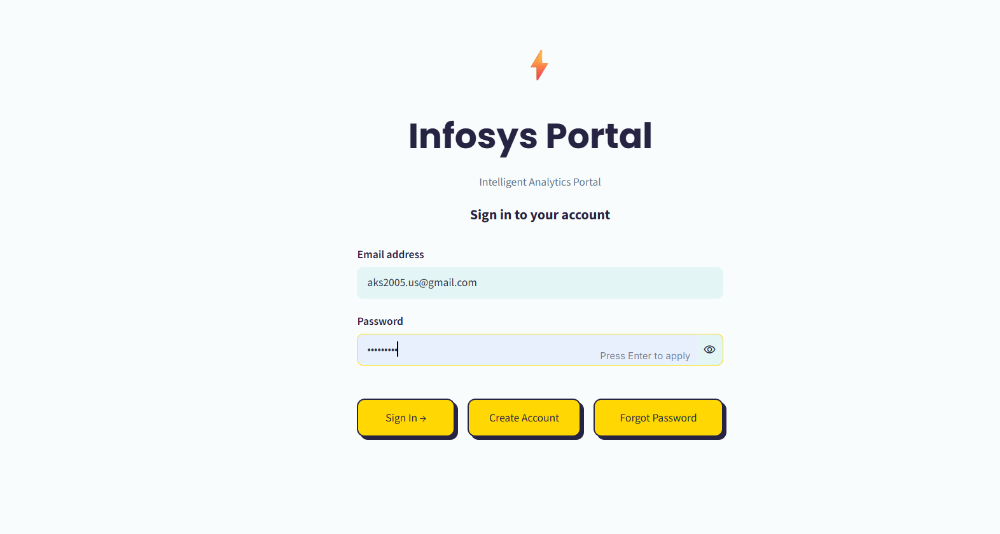
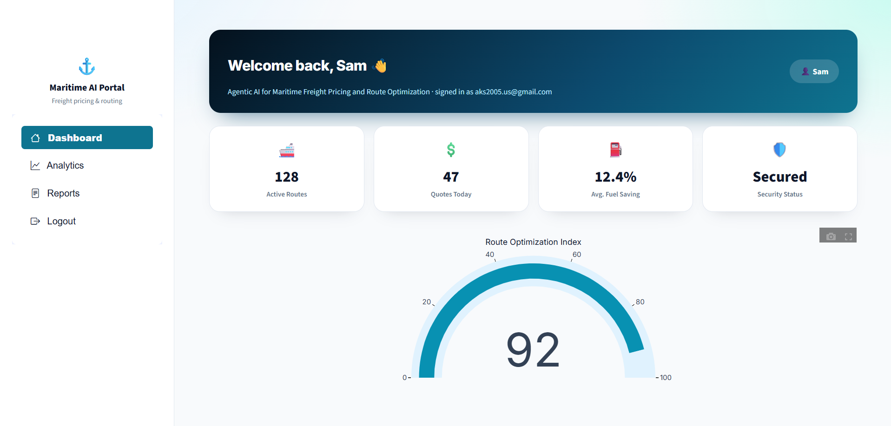
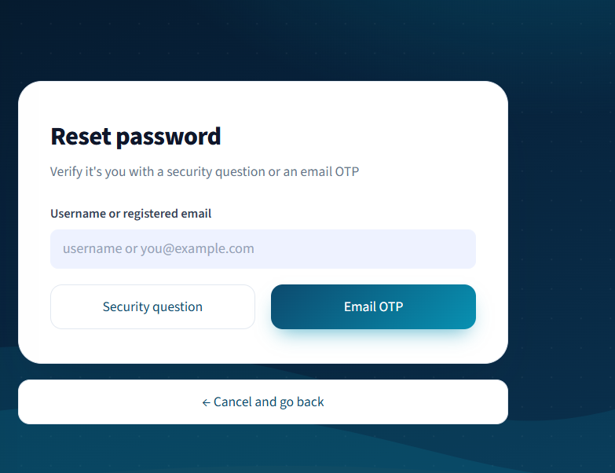
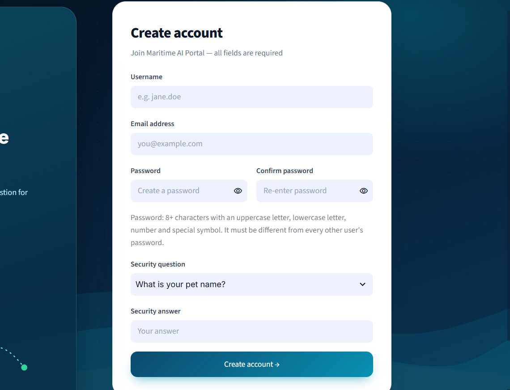
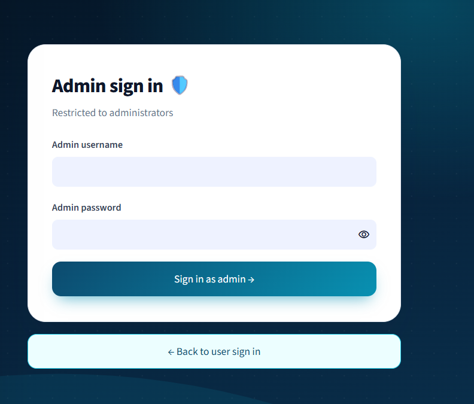
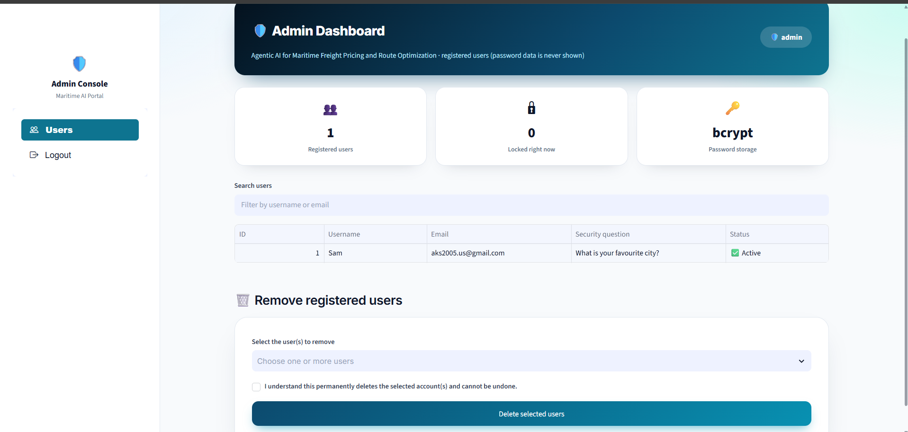

# Agentic AI for Maritime Freight Pricing and Route Optimization
### Infosys Springboard Internship 7.0 — Milestone 1: User Authentication Module

**Author:** `<Your Name>`  ·  **Institute:** ITER, S'O'A University, Bhubaneswar

---

## 1. What is Milestone 1?

The full project builds AI agents that price maritime freight and plan optimal sea routes.
Before any of that can be used, people need a safe way to get in. **Milestone 1 is that front door:
a complete user-authentication module** — sign up, sign in, password recovery, session handling,
an admin console and brute-force protection — built as a Streamlit web app that runs inside
Google Colab and is exposed to the internet through an ngrok tunnel.

Later milestones (pricing agent, route optimizer) will sit behind this login.

---

## 2. Features

### Authentication
- **Sign up** — username, email, password, confirm password, security question and answer. All fields mandatory.
  Duplicate usernames and emails are rejected with a clear message.
- **Sign in** — with **username or email** plus password. A wrong login shows one generic error, so it never reveals whether the username or the password was wrong.
- **Forgot password — two recovery routes**
  - **Security question:** enter username/email, answer the question chosen at signup, set a new password.
  - **Email OTP:** a 6-digit one-time code is emailed through Gmail (valid 5 minutes), verified, then a new password is set.
- **JWT sessions** — a signed token (HS256, 2-hour expiry) is issued only at login and checked before every dashboard page. Signup and password reset send the user back to Login; a fresh token is issued only by signing in.

### Security rules
- **Field validation** on every form: no empty submissions, email format, and strong passwords.
- **Different password for every user** — a password already used by another account is rejected at signup and at reset.
- **Brute-force lock** — **3 wrong attempts lock the account for 30 seconds**, with a live countdown. This applies to:
  - wrong password at login,
  - wrong OTP (the old OTP is also cancelled, so a new one must be requested),
  - wrong security-question answer,
  - wrong admin credentials.
  The counters are stored in the database, so refreshing the page does not reset a lock.
- Passwords and security answers are stored only as **bcrypt hashes**. Nothing sensitive is hard-coded; every secret comes from **Colab Secrets**.

### Dashboards
- **User dashboard** — welcome message with the logged-in username and email, summary cards, a gauge, and a Logout button that clears the session.
- **Admin dashboard** — separate admin login (credentials from Colab Secrets, not a signup account).
  - Lists every registered user (id, username, email, security question, locked/active status) with search. **No password data is ever shown.**
  - **Remove registered users:** select one or more users, confirm, and delete them permanently.

### Data persistence
- Users are stored in a **SQLite database on Google Drive**, so registered accounts survive notebook re-runs and Colab runtime restarts.

---

## 3. Tech stack

| Layer | Technology |
|---|---|
| Web UI | Streamlit 1.66.1, custom CSS, `streamlit-option-menu`, Plotly |
| Sessions | JWT (`PyJWT`, HS256) kept in Streamlit session state |
| Password security | `bcrypt` hashing; HMAC-SHA256 fingerprint for the unique-password rule |
| Database | SQLite (file stored on Google Drive) |
| Email / OTP | Gmail SMTP over SSL with a Google App Password |
| Public access | ngrok tunnel (`pyngrok`) |
| Runtime | Google Colab (Python 3) |

---

## 4. Repository layout

```
Milestone1/
├── README.md
├── Milestone1_Authentication_v2.ipynb     # the notebook (outputs cleared)
└── screenshots/
    ├── 01_login.png
    ├── 02_signup.png
    ├── 03_forgot_security_question.png
    ├── 04_forgot_otp.png
    ├── 05_otp_email.png
    ├── 06_user_dashboard.png
    └── 07_admin_dashboard.png
```

---

## 5. One-time setup

### 5.1 ngrok authtoken
1. Create a free account at <https://ngrok.com/> and open the dashboard.
2. Copy your personal **Authtoken**.

### 5.2 Gmail App Password (for OTP emails)
1. Turn on **2-Step Verification** for the Gmail account (the App Password option does not appear without it).
2. In Google Account settings, search for **App passwords** and create one (for example, named `Infosys`).
3. Copy the 16-character password **before** clicking Done — Google shows it only once.

### 5.3 Colab Secrets
In Colab, open the 🔑 **Secrets** panel, add each secret below and switch **Notebook access ON** for every one.

| Secret name | Value |
|---|---|
| `JWT_SECRET` | any long random string (signs session tokens) |
| `NGROK_AUTHTOKEN` | token from step 5.1 |
| `EMAIL_ADDRESS` | Gmail address that sends the OTP |
| `EMAIL_PASSWORD` | App Password from step 5.2 |
| `ADMIN_USERNAME` | username for the admin login |
| `ADMIN_PASSWORD` | password for the admin login |

---

## 6. How to run the notebook

1. Open `Milestone1_Authentication_v2.ipynb` in Google Colab.
2. Run the cells **top to bottom**:
   1. **Install packages.**
   2. **Setup** — mounts Google Drive (allow access when asked), loads all Colab Secrets and prints `Configured ✅` for each. If any secret is missing it stops and tells you which one.
   3. **`%%writefile app.py`** — writes the Streamlit app.
   4. **Launch** — starts Streamlit and the ngrok tunnel and prints a public URL.
3. Open the printed URL in your browser. If ngrok shows a "Visit Site" warning page, click it.
4. Use the app:
   - Create an account on **Create account**, then sign in.
   - Use **Forgot password?** to test both recovery routes.
   - Use **Admin login** with the `ADMIN_USERNAME` / `ADMIN_PASSWORD` you stored in Colab Secrets.
5. To stop, press the Colab **Stop** button.

> **Re-running:** registered users stay in `MyDrive/Infosys_Portal/infosys_portal.db`.
> Delete that file only if you want a completely fresh database.

---

## 7. Validation rules

| Field | Rule |
|---|---|
| Any form | No required field may be empty |
| Email | At least 2 letters before `@`, at least 2 letters between `@` and the last dot, at least 2 letters after the last dot (e.g. `ab@cd.ef`) |
| Username | 3–30 characters: letters, numbers, space, `.`, `_`, `-` (no `@`); must be unique |
| Password | 8–64 characters with an uppercase letter, a lowercase letter, a number and a special symbol |
| Confirm password | Must exactly match the password |
| Password uniqueness | Must not be used by any other account |

---

## 8. How the main pieces work

- **Session:** `make_jwt()` creates the token at login; `verify_jwt()` is checked on every page load of the dashboard. An invalid or expired token sends the user back to Login.
- **Lock-out:** a `lockouts` table stores attempts and a `locked_until` time per account key (`login:<email>`, `otp:<email>`, `sq:<email>`, `admin:<name>`). Because it lives in the database, a page refresh cannot bypass it.
- **Unique passwords:** bcrypt hashes are salted, so two identical passwords never produce the same hash. A keyed HMAC fingerprint of each password is stored beside the hash to detect "already used by someone else".
- **Persistence:** the SQLite file path is passed to the app through the `DB_PATH` environment variable, which the setup cell points at Google Drive.

---

## 9. Security checklist before uploading

- [x] All secrets read from Colab Secrets — none typed into the notebook
- [x] Restart and run all cells once to confirm a clean run
- [x] **Edit → Clear all outputs** so no URLs, tokens or OTPs stay visible
- [x] Search the notebook for your real email address, JWT secret, ngrok token and admin password

---
## Screenshots

### 1. Login Page


### 2. User Dashboard


### 3. Forgot Password


### 4. Create Account


### 5. Admin Login


### 6. Admin Dashboard



